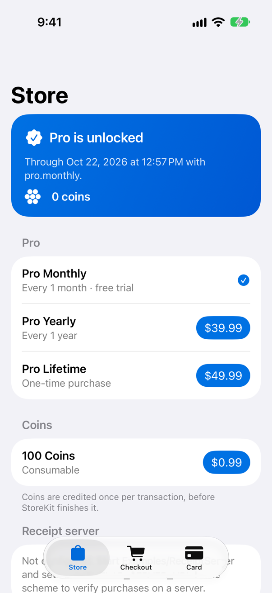
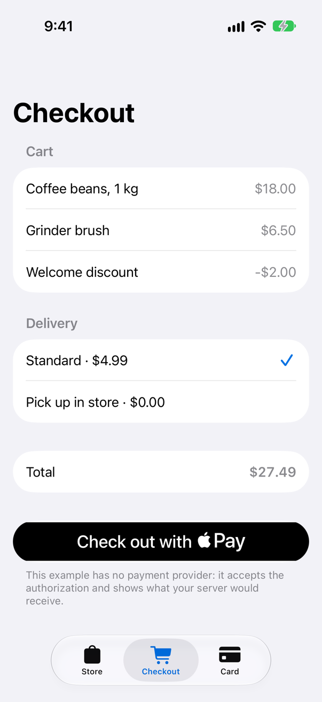
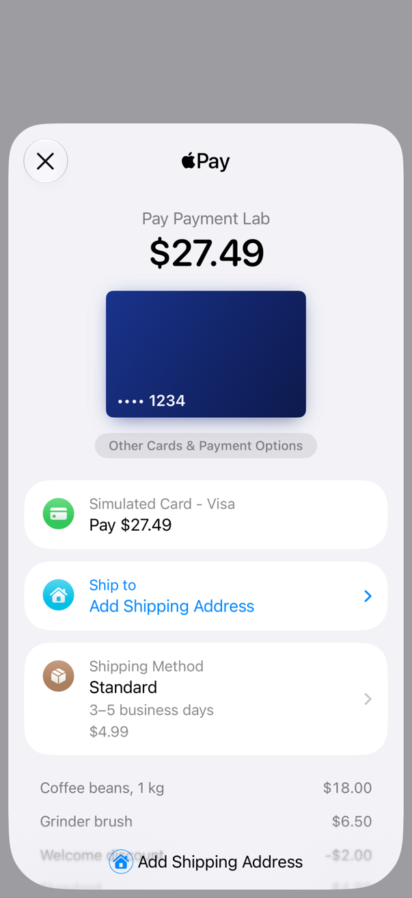
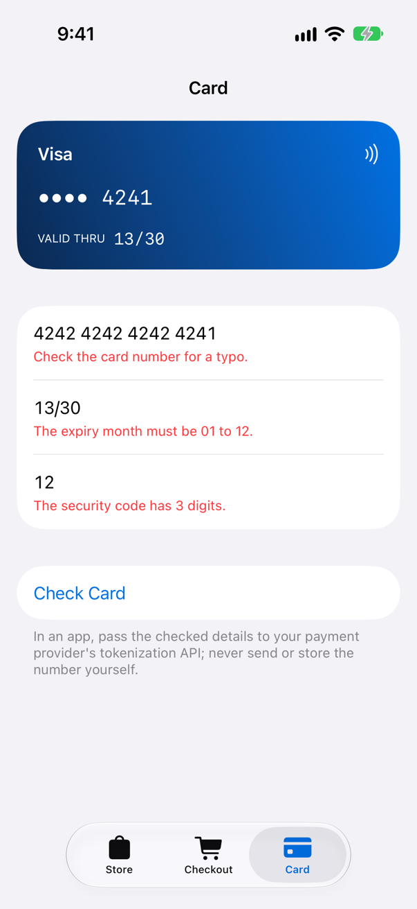
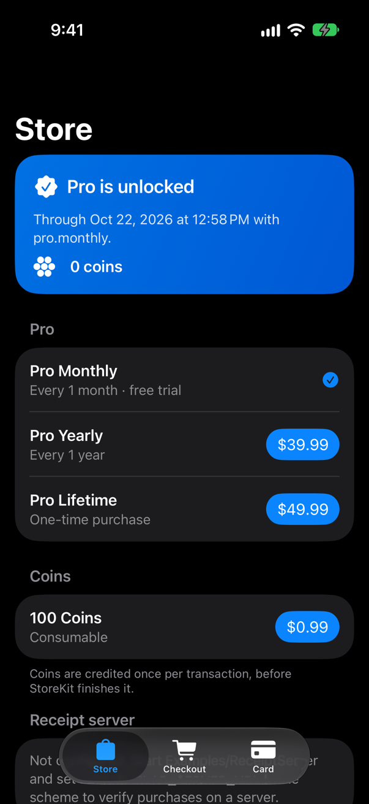
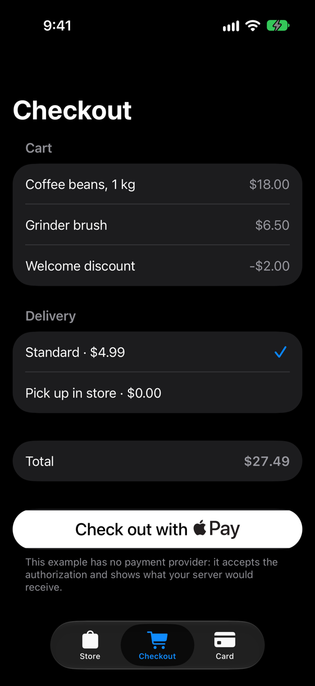
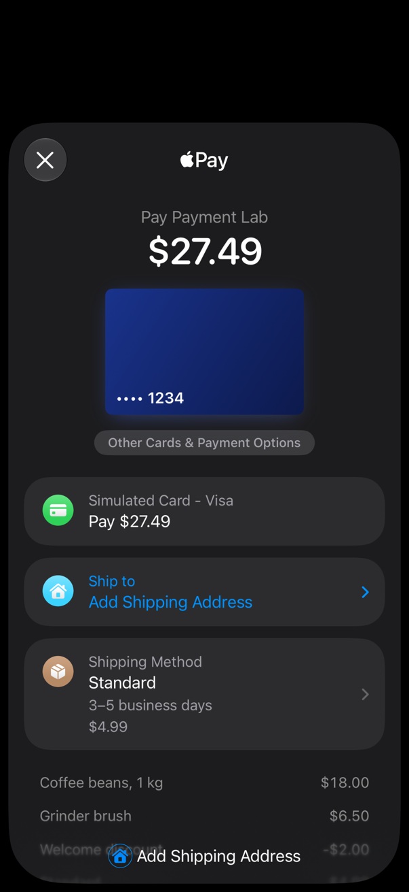
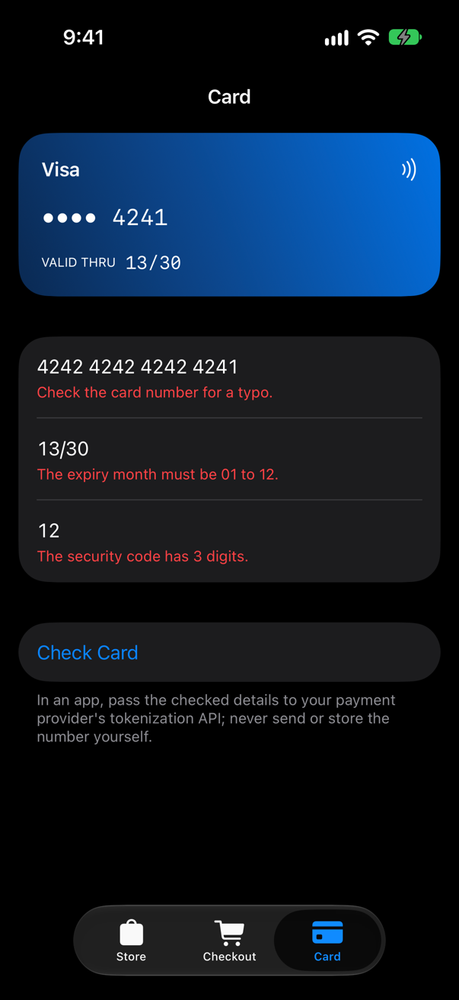

<!-- i18n-source: README.md@98fd5d725c83d31c454fd5f95f5236619ebe7f14 status=reviewed -->
<!-- brand:start -->

<p align="center"><picture><source media="(prefers-color-scheme: dark)" srcset="https://raw.githubusercontent.com/muhittincamdali/iOS-Payment-Processing-Framework/master/.github/brand/banner-dark.svg"><source media="(prefers-color-scheme: light)" srcset="https://raw.githubusercontent.com/muhittincamdali/iOS-Payment-Processing-Framework/master/.github/brand/banner-light.svg"></picture></p>

<!-- lang-selector:start -->
<p align="center"><a href="README.md">English</a> · <a href="README.tr.md">Türkçe</a> · <a href="README.zh-CN.md">简体中文</a> · <a href="README.ja.md">日本語</a> · <a href="README.ko.md">한국어</a> · <a href="README.es.md">Español</a> · <a href="README.de.md">Deutsch</a> · <a href="README.fr.md">Français</a> · <a href="README.pt-BR.md">Português (Brasil)</a> · <a href="README.ru.md">Русский</a></p>
<!-- lang-selector:end -->

<p align="center">
<a href="https://github.com/muhittincamdali/iOS-Payment-Processing-Framework/actions/workflows/ci.yml"></a>
<a href="https://github.com/muhittincamdali/iOS-Payment-Processing-Framework/releases"><picture><source media="(prefers-color-scheme: dark)" srcset="https://raw.githubusercontent.com/muhittincamdali/iOS-Payment-Processing-Framework/master/.github/brand/badge-version-dark.svg"><source media="(prefers-color-scheme: light)" srcset="https://raw.githubusercontent.com/muhittincamdali/iOS-Payment-Processing-Framework/master/.github/brand/badge-version-light.svg"></picture></a>
<a href="https://github.com/muhittincamdali/iOS-Payment-Processing-Framework/blob/master/Package.swift"><picture><source media="(prefers-color-scheme: dark)" srcset="https://raw.githubusercontent.com/muhittincamdali/iOS-Payment-Processing-Framework/master/.github/brand/badge-platforms-dark.svg"><source media="(prefers-color-scheme: light)" srcset="https://raw.githubusercontent.com/muhittincamdali/iOS-Payment-Processing-Framework/master/.github/brand/badge-platforms-light.svg"></picture></a>
<a href="https://github.com/muhittincamdali/iOS-Payment-Processing-Framework/blob/master/Package.swift"><picture><source media="(prefers-color-scheme: dark)" srcset="https://raw.githubusercontent.com/muhittincamdali/iOS-Payment-Processing-Framework/master/.github/brand/badge-language-dark.svg"><source media="(prefers-color-scheme: light)" srcset="https://raw.githubusercontent.com/muhittincamdali/iOS-Payment-Processing-Framework/master/.github/brand/badge-language-light.svg"></picture></a>
<a href="https://github.com/muhittincamdali/iOS-Payment-Processing-Framework/blob/master/LICENSE"><picture><source media="(prefers-color-scheme: dark)" srcset="https://raw.githubusercontent.com/muhittincamdali/iOS-Payment-Processing-Framework/master/.github/brand/badge-license-dark.svg"><source media="(prefers-color-scheme: light)" srcset="https://raw.githubusercontent.com/muhittincamdali/iOS-Payment-Processing-Framework/master/.github/brand/badge-license-light.svg"></picture></a>
</p>

<p align="center">
<a href="#クイックスタート"><picture><source media="(prefers-color-scheme: dark)" srcset="https://raw.githubusercontent.com/muhittincamdali/iOS-Payment-Processing-Framework/master/.github/brand/button-start-ja-dark.svg"><source media="(prefers-color-scheme: light)" srcset="https://raw.githubusercontent.com/muhittincamdali/iOS-Payment-Processing-Framework/master/.github/brand/button-start-ja-light.svg"></picture></a>
<a href="https://muhittincamdali.github.io/iOS-Payment-Processing-Framework/documentation/paymentkit/"><picture><source media="(prefers-color-scheme: dark)" srcset="https://raw.githubusercontent.com/muhittincamdali/iOS-Payment-Processing-Framework/master/.github/brand/button-docs-ja-dark.svg"><source media="(prefers-color-scheme: light)" srcset="https://raw.githubusercontent.com/muhittincamdali/iOS-Payment-Processing-Framework/master/.github/brand/button-docs-ja-light.svg"></picture></a>
<a href="https://github.com/muhittincamdali/iOS-Payment-Processing-Framework/tree/master/Examples"><picture><source media="(prefers-color-scheme: dark)" srcset="https://raw.githubusercontent.com/muhittincamdali/iOS-Payment-Processing-Framework/master/.github/brand/button-examples-ja-dark.svg"><source media="(prefers-color-scheme: light)" srcset="https://raw.githubusercontent.com/muhittincamdali/iOS-Payment-Processing-Framework/master/.github/brand/button-examples-ja-light.svg"></picture></a>
</p>

> このドキュメントは英語版 README の翻訳です。内容が異なる場合は英語版が最新です。

<!-- brand:end -->

PaymentKit は、Apple プラットフォーム向けアプリの決済コードのための Swift パッケージです。StoreKit 2 でアプリ内課金を販売し、Apple Pay を受け付け、金額とカード情報を扱います。気づかないうちに失敗しがちな部分を解消します。コンテンツを届ける前に完了した購入は失われる、`19.99` のような `Decimal` リテラルは実際には `19.98999999999999488` である、アプリが終了している間に届いた返金ではアクセス権が取り消されない、カード番号が `print` 経由でログに残る、といった問題です。リポジトリには、iOS のサンプルアプリと、Apple の App Store Server Library で購入を検証する Node サーバーも含まれています。このパッケージは、Apple の SDK 以外の依存関係を持ちません。

## 主な特長

- **届けてから完了する購入** — `Store` は StoreKit の署名を確認し、検証済みの各トランザクションを `deliver` クロージャに渡して、それが戻ってから初めて完了します。配信に失敗したトランザクションは、次回の起動時にもう一度届きます。返金は新しい購入ではなく `.revoked` として届きます。
- **コインは一度だけ付与** — クレジットが定義された消耗型アイテムは台帳に記録されます。台帳は残高と処理済みトランザクションを 1 回のアトミックな書き込みで保存するため、重複配信、`finish()` 前の再起動、返金があっても二重に付与されることはありません。
- **App Store に追従するアクセス権** — 更新、返金、Ask to Buy の承認、ほかのデバイスでの購入は、`entitlements` に自動的に反映されます。アプリの起動中に期限が切れたサブスクリプションは、有効期限の時刻に取り除かれます。App Store が更新できなかったサブスクリプションは、Billing Grace Period が終わるまでアクセス権を保ちます。
- **正確な金額** — `Money` は ISO 4217 通貨の最小単位で金額を保持します。小数桁が多すぎる場合、`NaN`、オーバーフロー、通貨の混在は、丸めたりクラッシュしたりせずにエラーをスローし、分割しても 1 セントも失われません。
- **検証済みの Apple Pay リクエスト** — `ApplePayRequest` は、PassKit に渡す前に加盟店、通貨、ラベル、合計を検証し、`ApplePayController` は async/await で支払い結果を報告します。
- **漏れないカード情報** — `CardNumber`、`CardSecurityCode`、`CardForm` は入力（ブランド、桁数、Luhn、有効期限）を検証し、ログ、`dump`、デバッガでは `•••• 4242` と表示されます。
- **エンドツーエンドでテスト済み** — macOS と iPhone シミュレータで 141 件の Swift Testing テスト、サンプルアプリで 11 件の StoreKit テストと 4 件の UI テスト（Xcode 経由の本物の StoreKit と本物の Apple Pay シート）、レシートサーバーで 38 件のテストを実施しています。

## クイックスタート

**1. パッケージを追加する**

Xcode で **File › Add Package Dependencies…** を選び、リポジトリの URL を入力します。

```text
https://github.com/muhittincamdali/iOS-Payment-Processing-Framework.git
```

`PaymentKit` ライブラリをアプリのターゲットに追加します。

**2. モジュールをインポートする**

```swift
import PaymentKit
```

**3. 使ってみる**

新しい iOS アプリの `ContentView.swift` を次の内容に置き換えます。

```swift
import PaymentKit
import SwiftUI

struct ContentView: View {
    @State private var store = Store(catalog: [
        .autoRenewable("pro.monthly", unlocks: "pro"),
        .nonConsumable("pro.lifetime", unlocks: "pro")
    ])

    var body: some View {
        List(store.products) { product in
            Button("\(product.displayName) · \(product.displayPrice)") {
                Task { try? await store.purchase(product) }
            }
        }
        .safeAreaInset(edge: .bottom) {
            Text(store.hasEntitlement("pro") ? "Pro is unlocked" : "Pro is locked")
        }
        .task { await store.start() } // loads products, listens for renewals and refunds
    }
}
```

App Store Connect にまだ商品がない段階でシミュレータで購入を試すには、StoreKit 構成ファイル（**File › New › File from Template… › StoreKit Configuration File**）を追加し、自動更新サブスクリプション `pro.monthly` と非消耗型アイテム `pro.lifetime` を登録して、**Product › Scheme › Edit Scheme… › Run › Options › StoreKit Configuration** で選択します。アプリを実行して商品をタップすると、購入後にテキストが **Pro is unlocked** に変わります。

## インストール

### Swift Package Manager

Xcode で **File › Add Package Dependencies…** を選び、リポジトリの URL を入力します。

```text
https://github.com/muhittincamdali/iOS-Payment-Processing-Framework.git
```

または `Package.swift` の `dependencies` に追加します。

```swift
dependencies: [
    .package(url: "https://github.com/muhittincamdali/iOS-Payment-Processing-Framework.git", from: "2.0.0")
],
targets: [
    .target(name: "YourApp", dependencies: [
        .product(name: "PaymentKit", package: "iOS-Payment-Processing-Framework")
    ])
]
```

## 使い方

以下のサンプルは
[`Examples/PaymentLab/PaymentLab/ReadmeSamples.swift`](Examples/PaymentLab/PaymentLab/ReadmeSamples.swift)
からコピーしたものです。サンプルアプリとパッケージのテストがこのファイルをコンパイルします。

### アプリ内課金を販売する

アプリの起動時に `Store` を 1 つ作成し、すぐに `start()` を呼び出します。検証済みの新しいトランザクションと返金は、StoreKit が完了させる前にすべて `deliver` を通ります。ここでエラーをスローするとトランザクションは未完了のままになり、StoreKit は次回の起動時にもう一度配信します。返金のアクセスとコインは `deliver` の実行前に取り消されます。購入の完了処理中に届いた返金は、その購入と一緒に完了し、もう一度届くことはないためです。

```swift
@MainActor
func makeStore(server: URL) -> Store {
    Store(catalog: [
        .autoRenewable("pro.monthly", unlocks: "pro"),
        .autoRenewable("pro.yearly", unlocks: "pro"),
        .nonConsumable("pro.lifetime", unlocks: "pro"),
        .consumable("coins.100", credits: 100, to: "coins") // store.balance(of: "coins")
    ]) { change in
        // Runs for each new verified transaction (.granted) and each refund (.revoked) before
        // StoreKit finishes it. Throwing keeps it unfinished and StoreKit sends it again on the
        // next launch, so the server must accept repeats of the same transaction.
        try await sendToServer(change.transaction.signedTransaction, server: server)
    }
}
```

`store.hasEntitlement("pro")` は、Pro がいま解除されているかどうかを返します。この値は変更のたびに StoreKit の検証済みトランザクションから再計算されるため、返金、期限切れ、アップグレードのいずれでもアクセス権は取り消され、値が積み上げられることはありません。StoreKit が検証できないトランザクションは、配信も完了もされません。

コインは、StoreKit が同じトランザクションを何度送ってきても、`ConsumableLedger` がトランザクションごとに 1 回だけ付与します。コインを使うには `try await store.spend(30, of: "coins")` を呼び出します。台帳はデバイス上にあり、StoreKit が送ってくる返金しか見えません。まだ完了していないパックの返金は届き、そのパックは何も付与しません。しかし、完了済みのパックの返金を StoreKit はアプリに送らないため、そのコインは台帳に残ります。その返金を知るのはサーバーだけで、`REFUND` の App Store Server Notification で通知されます。価値のあるものについては、サーバーが信頼できる情報源です。

### 購入を処理する

`purchase(_:options:)` は、型付きの `StoreError` をスローします。

```swift
@MainActor
func buy(_ product: StoreProduct, in store: Store, account: UUID) async -> String {
    do {
        switch try await store.purchase(product, options: PurchaseOptions(appAccountToken: account)) {
        case .purchased(let transaction):
            return "Bought \(transaction.productID)"
        case .pending:
            return "Waiting for approval (Ask to Buy)"
        case .cancelled:
            return "Cancelled"
        }
    } catch .verificationFailed {
        return "The App Store could not verify the purchase; nothing was unlocked."
    } catch {
        return error.localizedDescription
    }
}
```

### サーバーで購入を検証する

各トランザクションには、App Store が署名した JWS である `signedTransaction` が含まれます。これを（上の `makeStore` のように）`deliver` から、Apple の App Store Server Library で検証するサーバーへ送ります。[`Examples/ReceiptServer`](Examples/ReceiptServer) はそのようなサーバーで、Node 24 で動作します。

```sh
cd Examples/ReceiptServer
npm ci
BUNDLE_ID=com.example.shop APPLE_ENVIRONMENT=Sandbox npm start
```

このサーバーは、Apple Root CA - G3 までの証明書チェーン、バンドル識別子、環境を確認し、app account token ごとのエンタイトルメントを、再起動しても失われないファイルに保持します。また、返金でアクセス権が取り消され、Billing Grace Period の間はアクセス権が保たれるよう App Store Server Notifications を受け取り、消耗型アイテムのクレジットは 1 回だけ付与し、すべてのリクエストを制限します。Xcode で StoreKit 構成ファイルを使って行ったトランザクションは App Store によって署名されません。サーバーは `APPLE_ENVIRONMENT=Xcode ALLOW_UNVERIFIED_TRANSACTIONS=1` のときだけそれらを受け入れ、`NODE_ENV=production` では決して受け入れません。

### 金額

```swift
func moneySamples() throws -> (total: Money, shares: [Money]) {
    let price = try Money("19.99", .usd)
    let tax = try price.multiplied(by: Decimal(8) / 100) // 1.60, rounded half to even
    let total = try price.adding(tax)                    // 21.59 USD
    print(total.minorUnits)                              // 2159, what payment APIs expect
    print(total.formatted(locale: Locale(identifier: "en_US"))) // $21.59

    let typed = try Money(parsing: "1.234,50", currency: .eur, locale: Locale(identifier: "de_DE"))
    let shares = try typed.split(into: 3)                // 411.50, 411.50, 411.50 EUR
    print(shares.map(\.description))

    do {
        _ = try Money("10.999", .usd)
    } catch {
        print("US dollars have two decimals: \(error)") // never rounded silently
    }
    return (total, shares)
}
```

金額は文字列または最小単位で記述してください。`Decimal` リテラルの `19.99` は `Double` を経由するため、`Money` は `19.98999999999999488` を請求してしまう代わりに、これを拒否します。

### Apple Pay

```swift
func makeApplePayRequest() throws -> ApplePayRequest {
    var request = ApplePayRequest(
        merchantIdentifier: "merchant.com.example.shop",
        merchantName: "Example Shop",
        countryCode: "US",
        currency: .usd,
        items: [
            ApplePaySummaryItem("Coffee beans", try Money("18.00", .usd)),
            ApplePaySummaryItem("Discount", try Money("-2.00", .usd))
        ]
    )
    request.shippingMethods = [
        ApplePayShippingMethod(id: "standard", label: "Standard", detail: "3–5 days", amount: try Money("4.99", .usd))
    ]
    request.requiredShippingFields = [.name, .postalAddress]
    try request.validate() // currency, labels, merchant ID, total ≥ 0
    return request
}
```

```swift
struct CheckoutButton: View {
    let request: ApplePayRequest
    let server: URL
    @State private var controller = ApplePayController()

    var body: some View {
        PayWithApplePayButton(.buy) {
            Task {
                do {
                    let outcome = try await controller.pay(request) { payment in
                        // Charge the token through your server and payment provider.
                        do {
                            try await chargeOnServer(payment.token.serverPayload(), server: server)
                            return .success
                        } catch {
                            return .failure(message: "The payment did not go through.")
                        }
                    }
                    if case .paid(let payment) = outcome {
                        print("Paid with", payment.token.displayName ?? "Apple Pay")
                    }
                } catch {
                    print("Apple Pay could not start:", error.localizedDescription)
                }
            }
        }
        .frame(height: 48)
    }
}
```

### カード情報

```swift
func checkCard(number: String, expiry: String, securityCode: String) -> String {
    let form = CardForm(number: number, expiry: expiry, securityCode: securityCode)
    switch form.validate() {
    case .success(let card):
        // print(card.number) shows "•••• 4242"; hand card.number.unmaskedDigits to your
        // payment provider's tokenization API and nowhere else.
        return "\(card.number.brand.displayName) \(card.number) is valid"
    case .failure(let errors):
        return [errors.number, errors.expiry, errors.securityCode]
            .compactMap { $0?.localizedDescription }
            .joined(separator: "\n")
    }
}
```

カード番号を自前の入力欄で受け付けると、アプリは PCI DSS の対象範囲に入ります。可能な場合は、Apple Pay か決済事業者のカード入力欄を使うことをおすすめします。

### テスト

`TestStoreClient` は、商品とトランザクションをメモリ上に保持し、返金、更新、アップグレード、Family Sharing、繰り返しの配信、Ask to Buy の承認、ほかのデバイスでの購入をシミュレートします。そのため、購入ロジックを通常のユニットテストで実行できます。

```swift
@MainActor
func refundRemovesPro() async throws -> Bool {
    let client = TestStoreClient(products: [.preview(id: "pro.lifetime", kind: .nonConsumable)])
    let store = Store(catalog: [.nonConsumable("pro.lifetime", unlocks: "pro")], client: client)
    await store.start()

    guard case .purchased(let transaction) = try await store.purchase(store.products[0]) else { return false }
    let unlocked = store.hasEntitlement("pro")         // true
    try await client.refund(transaction.id)            // as if Apple refunded it
    await store.refreshEntitlements()
    return unlocked && !store.hasEntitlement("pro")    // access is gone
}
```

## デモ

| ストア | チェックアウト | Apple Pay シート | カードフォーム |
| ------ | -------------- | ---------------- | -------------- |
|  |  |  |  |
|  |  |  |  |

スクリーンショットは、サンプルアプリの UI テストを iPhone シミュレータで実行して取得したもので、[`scripts/capture-screenshots.sh`](scripts/capture-screenshots.sh) が実行します。Xcode の StoreKit テストで購入したサブスクリプション、カートと合計金額が表示された本物の Apple Pay シート、そして入力ミスのあるカードを確認したあとのカードフォームです。

ご自身で試すには、[`Examples/PaymentLab`](Examples/PaymentLab) にある `PaymentLab.xcodeproj` を開き、iPhone シミュレータを選んで **Run** を押します。レシートサーバーと組み合わせて実行する方法は、[Examples/README.md](Examples/README.md) を参照してください。

## ドキュメント

API リファレンスと解説記事：

- [API リファレンス](https://muhittincamdali.github.io/iOS-Payment-Processing-Framework/documentation/paymentkit/)
  （DocC。`master` から GitHub Pages に公開）
- ローカルでは、Xcode の **Product › Build Documentation** でビルドするか、コマンドラインから実行します。

```sh
xcodebuild docbuild -scheme PaymentKit -destination 'generic/platform=macOS'
```

## ガイド

- [Getting Started](https://muhittincamdali.github.io/iOS-Payment-Processing-Framework/documentation/paymentkit/gettingstarted)
  — パッケージの追加、商品の一覧表示、シミュレータでの購入
  （[ソース](Sources/PaymentKit/PaymentKit.docc/GettingStarted.md)）。
- [Selling In-App Purchases](https://muhittincamdali.github.io/iOS-Payment-Processing-Framework/documentation/paymentkit/sellinginapppurchases)
  — 各トランザクションの流れ、返金と重複配信、コインの残高、アクセス権の確認、購入の復元
  （[ソース](Sources/PaymentKit/PaymentKit.docc/SellingInAppPurchases.md)）。
- [Verifying Purchases on Your Server](https://muhittincamdali.github.io/iOS-Payment-Processing-Framework/documentation/paymentkit/verifyingpurchasesonyourserver)
  — 署名付きトランザクションの送信、サンプルサーバー、Xcode のトランザクション
  （[ソース](Sources/PaymentKit/PaymentKit.docc/VerifyingPurchasesOnYourServer.md)）。
- [Accepting Apple Pay](https://muhittincamdali.github.io/iOS-Payment-Processing-Framework/documentation/paymentkit/acceptingapplepay)
  — リクエスト、その検証、シート、決済事業者に渡すトークン
  （[ソース](Sources/PaymentKit/PaymentKit.docc/AcceptingApplePay.md)）。
- [Accepting Cards](https://muhittincamdali.github.io/iOS-Payment-Processing-Framework/documentation/paymentkit/acceptingcards)
  — 検証される内容、入力中のフォーマット、マスキング
  （[ソース](Sources/PaymentKit/PaymentKit.docc/AcceptingCards.md)）。
- [Working with Money](https://muhittincamdali.github.io/iOS-Payment-Processing-Framework/documentation/paymentkit/workingwithmoney)
  — どのイニシャライザを使うか、エラー、正確な分割
  （[ソース](Sources/PaymentKit/PaymentKit.docc/WorkingWithMoney.md)）。
- [Testing Purchases](https://muhittincamdali.github.io/iOS-Payment-Processing-Framework/documentation/paymentkit/testingpurchases)
  — `TestStoreClient` と Xcode の StoreKit テスト
  （[ソース](Sources/PaymentKit/PaymentKit.docc/TestingPurchases.md)）。

## 動作要件

| プラットフォーム | 最小バージョン        |
| ---------------- | --------------------- |
| iOS              | 17                    |
| macOS            | 14                    |
| watchOS          | 10                    |
| visionOS         | 1                     |
| ツールチェーン   | Swift 6.2 · Xcode 26+ |

Apple Pay は 4 つのプラットフォームすべてで利用できます。visionOS のアプリ内課金は、アプリのアクティブなウィンドウに表示されます。`Money`、`Currency`、カード関連の型は Foundation のみを使用します。CI は GitHub の `macos-26` ランナーイメージにあるデフォルトの Xcode でビルドします。パッケージ自体は Xcode 27 で開発しています。レシートサーバーには Node 24 が必要です。

## アーキテクチャ

- `Sources/PaymentKit` は役割ごとに分かれています。`Money/`（`Money`、`Currency`、パースとエンコード）、`Cards/`（番号、ブランド、有効期限、セキュリティコード、フォーム）、`Store/`（store、エンタイトルメント、App Store クライアント、テストクライアント）、`ApplePay/`（リクエスト、支払い値、コントローラ）です。
- `Store` は `@MainActor` の `@Observable` クラスです。App Store には `StoreClient` プロトコルを介してのみアクセスします。`AppStoreClient` は StoreKit 2 をラップし、`TestStoreClient` は状態をメモリ上に保持します。`EntitlementResolver` はトランザクションをアクセス権に変換する純粋な型で、StoreKit なしでテストできます。`ConsumableLedger` は actor で、消耗型トランザクションごとに 1 回だけクレジットを付与し、残高と処理済みトランザクションを 1 回のアトミックな書き込みでディスクに保存します。
- 外部からの入力には上限と範囲チェックがあります。金額とカード欄の文字数、スケーリング前および `Int64` への変換前の `Decimal` 値、`Duration` になる前の有効期限の更新遅延、購入数量、Apple Pay リクエストの項目数とラベルの長さ、StoreKit オブジェクトと処理済みトランザクションのキャッシュ、台帳ファイル（サイズ、エントリ、アカウント名、`Int64` のオーバーフロー）が対象です。
- `Examples/PaymentLab` は、アプリ内ホスト型の StoreKit テスト（`SKTestSession`）と UI テストを備えた iOS アプリです。`Examples/ReceiptServer` は、Apple の App Store Server Library を使った Node サーバーです。

テストをローカルで実行します。

```sh
swift test                                    # macOS
xcodebuild test -scheme PaymentKit \
  -destination 'platform=iOS Simulator,name=iPhone 17 Pro'
(cd Examples/ReceiptServer && npm ci && npm test)
```

## ロードマップ

- パッケージを Swift Package Index に追加する（`.spi.yml` はすでにリポジトリにあります）。
- 請求の再試行や猶予期間のメッセージ向けに、エンタイトルメントと並べてサブスクリプションの状態と更新情報（`Product.SubscriptionInfo.Status`）を提供する。
- レシートサーバーで署名するオファーコードとプロモーションオファー。

## コントリビューション

コントリビューションを歓迎します。pull request を作成する前に[コントリビューションガイド](https://github.com/muhittincamdali/iOS-Payment-Processing-Framework/blob/master/CONTRIBUTING.md)と[行動規範](https://github.com/muhittincamdali/.github/blob/main/CODE_OF_CONDUCT.md)をお読みください。セキュリティ上の問題は[セキュリティポリシー](https://github.com/muhittincamdali/.github/blob/main/SECURITY.md)に従って非公開で報告してください。

## ライセンス

MIT ライセンスで公開しています。詳細は [LICENSE](LICENSE) を参照してください。
